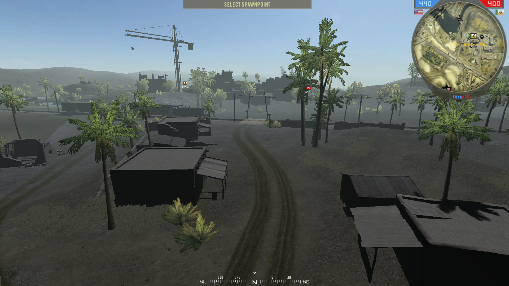
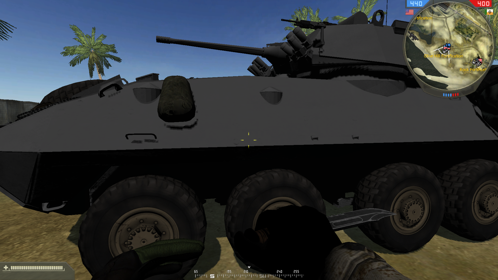

test measurements 

Method:
The colors of terrain, static and a vehicle have been replaced with middle grey #808080. Also hemimap has been removed to not skew the vehicle measurement.
Light was inputted by a constant distance of 0.5. So inputs were 0.5/0.5/0.5, 1.0/1.0/1.0, 1.5/1.5/1.5, etc. 
Then screenshots were made of representative sample surfaces. The image_color_analyzer.html tool was used to measure the OKLCH lightness in screenshots of sample surfaces.

Input | terrain | static | dynamic
------|---------|--------|---------
0.0   | 0       | 0      | 0
0.25  | 30.4    | 30.4   | 23.7
0.5	  | 37.7    | 42.8   | 35.5
0.75  | 4.6     | 54.3   | 45.6
1     | 51.2    | 65.2   | 56.1
1.5	  | 63.8    | 85.7   | 77
2.0   | 75.     | 100    | 100
2.5   | 87.3		|        | 
3.0   | 100			|        | 

*lightness values of different object classes under the same lighting conditions*

screen310dyn_05 and screen310_05 show different surface under the same lighting conditions and the same input value 0.5/0.5/0.5

